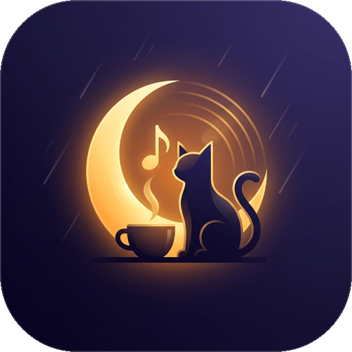
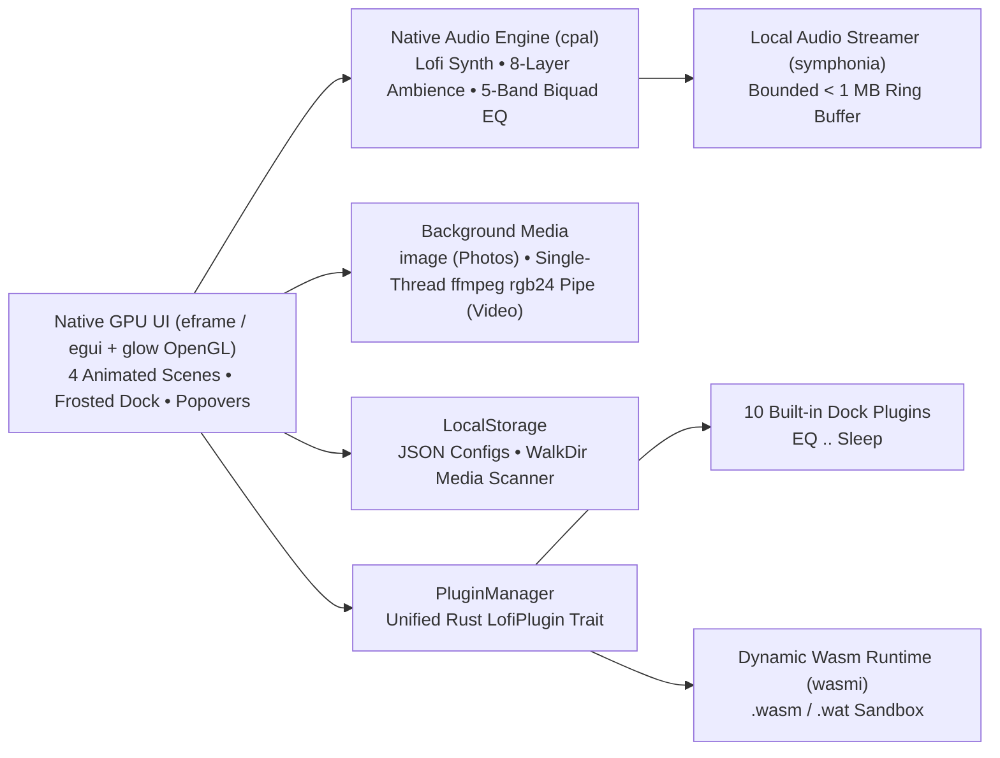

<div align="center">



# Kissa

**A whisper-quiet, 100% Pure-Rust local-first lofi desktop café — zero WebView, zero Chromium, zero Node.js — powered by `eframe`/`egui`, `cpal`, `symphonia` & WebAssembly plugins.**

[](https://github.com/Ash2sh/kissa-lofi/releases)
[](https://www.rust-lang.org/)
[-38bdf8?style=flat-square)](https://github.com/emilk/egui)
[-654FF0?style=flat-square&logo=webassembly&logoColor=white)](plugins/README.md)

[Features](#features) &bull;
[Inspiration](#inspiration--reference) &bull;
[Architecture](#architecture) &bull;
[RAM Footprint](#measured-ram-footprint) &bull;
[Module Suite](#modular-control-suite) &bull;
[Wasm Plugins](#webassembly-plugins) &bull;
[Quick Start](#quick-start)

<br />


</div>

---

## Inspiration & Reference

Named after Japan's cozy, dimly lit listening cafés (*jazz kissa*), **Kissa** uses the **[LofiCafe](https://lofi.cafe/)** website as its visual and interaction reference — capturing the calm full-bleed rainy-window atmosphere and compact bottom-overlay frosted-glass control dock, while reimagining the experience as a **private, ultra-low-resource 100% native Rust desktop client** with zero browser engine overhead, local media libraries, and extensible WebAssembly plugins.

---

## Features

<table>
  <tr>
    <td width="50%" valign="top">
      <h3>Native GPU Atmospheric Engine</h3>
      <ul>
        <li><strong>4 Built-in GPU Scenes:</strong> <em>Rainy Window Cat</em>, <em>Neon Rain Skyline</em>, <em>Midnight Starlight</em>, and <em>Warm Study Dusk</em> rendered directly via <code>egui::Painter</code>.</li>
        <li><strong>Custom Local Wallpapers:</strong> Drop or scan local <strong>photos</strong> (<code>.jpg</code>, <code>.png</code>, <code>.webp</code>, <code>.gif</code>) and looping <strong>videos</strong> (<code>.mp4</code>, <code>.webm</code>, <code>.mov</code>, <code>.mkv</code>) streamed into a single reused <code>rgb24</code> GPU texture.</li>
        <li><strong>Live Visual FX:</strong> Layer adjustable rain streaks, soft vignette, dimmer, and warm tint over any wallpaper.</li>
        <li><strong>Power-Aware Rendering:</strong> Adaptive FPS cap (<code>15 / 30 / 60 FPS</code>), zero MSAA/depth/stencil bloat, and automatic throttling when minimized.</li>
      </ul>
    </td>
    <td width="50%" valign="top">
      <h3>Native Rust Audio &amp; DSP</h3>
      <ul>
        <li><strong>Instant Lofi Synth Stations:</strong> 4 procedural Rust stations (<em>Chilling</em>, <em>Focusing</em>, <em>Drifting</em>, <em>Unwinding</em>) synthesized in real time via <code>cpal</code> with zero setup.</li>
        <li><strong>Streaming Local Music:</strong> Index local folders (<code>.mp3</code>, <code>.flac</code>, <code>.wav</code>, <code>.ogg</code>, <code>.m4a</code>, <code>.aac</code>) decoded in pure Rust via <code>symphonia</code> with a bounded <code>&lt; 1 MB</code> ring buffer &amp; seek support.</li>
        <li><strong>5-Band EQ &amp; Tape Filter:</strong> Real-time stereo biquad parametric equalizer + warm low-pass tape cutoff + soft limiter.</li>
        <li><strong>8-Layer Ambience Mixer:</strong> Mix <em>Rain</em>, <em>Vinyl</em>, <em>Fireplace</em>, <em>Thunder</em>, <em>Night Wind</em>, <em>Cafe</em>, <em>Forest</em>, and <em>Ocean</em> in real time.</li>
      </ul>
    </td>
  </tr>
  <tr>
    <td width="50%" valign="top">
      <h3>Extensible Dock Plugin Architecture</h3>
      <ul>
        <li><strong>Every Dock Button Is a Plugin:</strong> All 10 core modules (<code>EQ</code>, <code>Music</code>, <code>Visuals</code>, <code>Sounds</code>, <code>Scenes</code>, <code>History</code>, <code>Share</code>, <code>Keys</code>, <code>Focus</code>, <code>Sleep</code>) are built-in Rust plugins implementing <code>LofiPlugin</code>—toggle any of them on or off from the dock.</li>
        <li><strong>Dynamic WebAssembly (<code>wasmi</code>):</strong> Drop in external <code>.wasm</code> / <code>.wat</code> plugins to register brand-new buttons directly onto the bottom dock with interactive declarative panels and live DSP transforms.</li>
        <li><strong>Dedicated Plugin Manager (<code>G</code>):</strong> Manage built-in dock plugins and external Wasm plugins cleanly without cluttering Atmosphere Scenes.</li>
      </ul>
    </td>
    <td width="50%" valign="top">
      <h3>Zero-WebView Footprint</h3>
      <ul>
        <li><strong>Single 6.96 MB Native Binary:</strong> Zero Electron, zero WebView2, zero Chromium subprocesses, and zero Node.js toolchain.</li>
        <li><strong>~73–75% Lower Working Set RAM:</strong> Drops resident RAM from <code>409–519 MB</code> (Tauri + WebView2) down to <code>102 MB</code> idle and <code>141 MB</code> playing local video + MP3 + rain + Wasm DSP.</li>
        <li><strong>Private &amp; Offline:</strong> All configs, scenes, history, and focus tasks live locally in your OS app data directory with zero telemetry.</li>
      </ul>
    </td>
  </tr>
</table>

---

## Architecture



---

## Measured RAM Footprint

Measured on Windows x64 (`--release`, LTO + stripped) playing an `854×480` H.264 video wallpaper + local MP3 + Rain ambience + Wasm Tape Lab DSP over 23 seconds:

| Metric | Tauri v2 + WebView2 (`v0.1`) | Pure-Rust Native (`v0.2`) | Reduction |
| :--- | :---: | :---: | :---: |
| **Idle Working Set (Canvas Scene)** | `409.1 MB` (`7` procs) | **`102.2 MB`** (`1` proc) | **-75.0%** |
| **Idle Private Bytes** | `233.9 MB` (`7` procs) | **`109.6 MB`** (`1` proc) | **-53.1%** |
| **Video + Music + Rain Working Set** | `519.2 MB` (`8` procs) | **`140.9 MB`** (`3` procs) | **-72.9%** |
| **Video + Music + Rain Steady Private** | `300.4 MB` (`8` procs) | **`166.8 MB`** (`3` procs) | **-44.5%** |
| **Video Decode Init Peak Private** | `460.9 MB` | **`167.1 MB`** | **-63.7%** |
| **Standalone Release Binary** | `5.29 MB` (+ WebView2 runtime) | **`6.96 MB`** (zero runtime) | **100% Native** |

---

## Modular Control Suite

Kissa keeps every tool inside a clean, floating bottom-overlay bar with instant keyboard access:

| Key | Module | What It Does |
| :-: | :--- | :--- |
| `1` | **EQ** | 5-band native parametric EQ, tape low-pass filter, built-in/custom/Wasm presets & live Wasm DSP transforms |
| `2` | **Music** | Procedural Rust lofi stations, local music library & folder scanner, shuffle/repeat/seek |
| `3` | **Visuals** | Native GPU scenes, local photo/video wallpapers, atmosphere overlays & FPS power cap |
| `4` | **Sounds** | 8-layer procedural Rust ambient mixer |
| `5` | **Scenes** | Save and recall complete atmosphere snapshots (visual, FX, EQ, ambience & station) |
| `6` | **History** | Private local log of recently played tracks, stations, and scenes with one-click replay |
| `7` | **Share** | Export and import portable `lofi-scene-v1:...` codes offline |
| `8` | **Keys** | Full keyboard shortcuts overview, Cinema Mode (`H`), and Fullscreen (`F`) |
| `9` | **Focus** | Pomodoro / deep-work timer (`25m` / `50m` / breaks), soft chime & persistent session checklist |
| `0` | **Sleep** | Sleep timer (`15`–`90` min or custom) with smooth 30-second audio & ambience fade-out |
| *Ext* | **Tape *(Wasm)*** | Starter external `.wasm` dock plugin (`tape-lab.wasm`) proving third-party buttons on the dock |

> Open the dedicated **Plugin Manager** via the top-right **Plugins** button or shortcut `G` to show/hide any built-in dock plugin or install new `.wasm` / `.wat` dock buttons.

<details>
<summary><strong>Global Keyboard Shortcuts</strong></summary>

| Shortcut | Action |
| :---: | :--- |
| `Space` | Play / Pause |
| `M` | Mute / Unmute |
| `↑` / `↓` | Volume Up / Down |
| `N` / `P` | Next / Previous Track or Station |
| `1` – `9`, `0` | Toggle Dock Modules (`EQ` through `Sleep`) |
| `G` | Toggle Dedicated Plugin Manager |
| `H` | Toggle Cinema Mode (Hide / Show HUD) |
| `F` | Toggle Fullscreen |
| `Esc` | Close Active Popover or Exit Cinema Mode |

</details>

---

## WebAssembly Plugins

Kissa ships with a starter external `.wasm` dock plugin (`tape-lab.wasm`, registering the **Tape** button on the bottom dock) installed automatically into your local `plugins/` directory, plus a readable community example at [`plugins/rainy-lo-fi-warmth.wat`](plugins/rainy-lo-fi-warmth.wat).

Drop any `.wasm` or `.wat` plugin directly onto the Kissa window — or install it from the dedicated **Plugin Manager (`G`)** — to register a new button on the bottom dock dynamically at runtime. Full ABI v1 documentation is available in [`plugins/README.md`](plugins/README.md).

---

## Quick Start

### Prerequisites
- **[Rust](https://rustup.rs/)** (stable toolchain — no Node.js, no WebView2 required!)
- Optional: **[FFmpeg](https://ffmpeg.org/)** in `PATH` if you want to play local `.mp4` / `.webm` video wallpapers

### Clone & Run

```bash
git clone https://github.com/Ash2sh/kissa-lofi.git
cd kissa-lofi

# Launch Kissa in release mode
cargo run --release
```

### Build & Test

```bash
# Run all unit tests (Wasm runtime, plugin manager, WAT compilation, storage scanner)
cargo test

# Build optimized standalone release binary (LTO + stripped)
cargo build --release
```

---

## Alpha Status (`v0.2.0-alpha.1`)

Kissa is currently in **early alpha** and now runs as a **100% pure-Rust native desktop app** with zero WebView overhead:

- [x] Native `eframe` / `egui` (`glow` OpenGL) UI inspired by LofiCafe
- [x] Native `cpal` + `symphonia` real-time audio engine (4 stations, 8 ambience layers, 5-band biquad EQ, local streaming)
- [x] 4 animated GPU scenes + local photo (`image`) & single-buffer streaming video (`ffmpeg`) wallpapers
- [x] Unified `LofiPlugin` trait powering all 10 dock buttons + dynamic `wasmi` WebAssembly plugins
- [ ] Embedded ID3/Vorbis cover art & tag extraction for local audio tracks
- [ ] Optional custom Wasm visual shader plugin hooks
- [ ] Pre-built cross-platform release binaries via GitHub Actions

---

<div align="center">
  <sub>Built in 100% Pure Rust with eframe/egui, cpal, symphonia, wasmi &amp; rainy late-night vibes.</sub>
</div>
