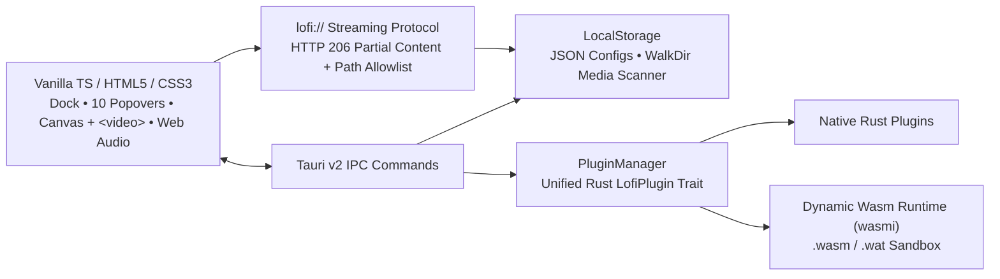

<div align="center">


# Kissa

**A whisper-quiet, local-first lofi desktop café built with Tauri v2, Rust, Vanilla TypeScript & WebAssembly plugins.**

[](https://github.com/Ash2sh/kissa-lofi/releases)
[](https://v2.tauri.app/)
[](https://www.rust-lang.org/)
[](https://www.typescriptlang.org/)
[-654FF0?style=flat-square&logo=webassembly&logoColor=white)](plugins/README.md)

[Features](#features) &bull;
[Inspiration](#inspiration--reference) &bull;
[Architecture](#architecture) &bull;
[Module Suite](#modular-control-suite) &bull;
[Wasm Plugins](#webassembly-plugins) &bull;
[Quick Start](#quick-start)

<br />


</div>

---

## Inspiration & Reference

Named after Japan's cozy, dimly lit listening cafés (*jazz kissa*), **Kissa** uses the **[LofiCafe](https://lofi.cafe/)** website as its visual and interaction reference — capturing the calm full-bleed rainy-window atmosphere and compact bottom-overlay frosted-glass control dock, while reimagining the experience as a **private, ultra-low-resource native desktop client** powered by local media libraries, zero frontend frameworks, and extensible WebAssembly plugins.

---

## Features

<table>
  <tr>
    <td width="50%" valign="top">
      <h3>Atmospheric Visual Engine</h3>
      <ul>
        <li><strong>4 Built-in Canvas Scenes:</strong> <em>Rainy Window Cat</em>, <em>Neon Rain Skyline</em>, <em>Midnight Starlight</em>, and <em>Warm Study Dusk</em>.</li>
        <li><strong>Custom Local Wallpapers:</strong> Drop or scan local <strong>photos</strong> (<code>.jpg</code>, <code>.png</code>, <code>.webp</code>, <code>.gif</code>, <code>.avif</code>) and looping <strong>videos</strong> (<code>.mp4</code>, <code>.webm</code>, <code>.mov</code>).</li>
        <li><strong>Live Canvas FX:</strong> Layer adjustable rain streaks, vignette, film grain, dimmer, warm tint, and blur over any wallpaper.</li>
        <li><strong>Power-Aware Rendering:</strong> Adaptive FPS cap (<code>15 / 30 / 60 FPS</code>), capped DPR (<code>&le; 1.5</code>), and automatic pause when hidden or minimized.</li>
      </ul>
    </td>
    <td width="50%" valign="top">
      <h3>Local-First Audio &amp; DSP</h3>
      <ul>
        <li><strong>Instant Lofi Synth Stations:</strong> 4 procedural Web Audio stations (<em>Chilling</em>, <em>Focusing</em>, <em>Drifting</em>, <em>Unwinding</em>) play immediately with zero setup.</li>
        <li><strong>Local Music &amp; Streams:</strong> Index local folders (<code>.mp3</code>, <code>.flac</code>, <code>.wav</code>, <code>.ogg</code>, <code>.m4a</code>, <code>.aac</code>, <code>.opus</code>) streamed via chunked <code>lofi://</code> byte-range responses, or add custom stream URLs.</li>
        <li><strong>5-Band EQ &amp; Tape Filter:</strong> Real Web Audio parametric equalizer + warm low-pass tape cutoff and custom presets.</li>
        <li><strong>8-Layer Ambience Mixer:</strong> Mix <em>Rain</em>, <em>Vinyl</em>, <em>Fireplace</em>, <em>Thunder</em>, <em>Night Wind</em>, <em>Cafe</em>, <em>Forest</em>, <em>Ocean</em>, plus local ambient audio loops.</li>
      </ul>
    </td>
  </tr>
  <tr>
    <td width="50%" valign="top">
      <h3>Dynamic WebAssembly Plugins</h3>
      <ul>
        <li><strong>Unified Rust Trait Interface:</strong> Native plugins and dynamic <code>.wasm</code> / <code>.wat</code> modules both implement <code>LofiPlugin</code>.</li>
        <li><strong>Sandboxed <code>wasmi</code> Runtime:</strong> Ultra-lightweight interpreter with tiny memory overhead and zero JIT bloat.</li>
        <li><strong>Live DSP &amp; Scenes:</strong> Plugins contribute EQ presets, atmospheric scenes, event hooks, and live DSP curve transforms.</li>
      </ul>
    </td>
    <td width="50%" valign="top">
      <h3>Ultra-Low Resource Footprint</h3>
      <ul>
        <li><strong>Zero JS Frameworks:</strong> Pure Vanilla TypeScript, HTML5, and CSS3 (~37 KB gzipped total frontend bundle).</li>
        <li><strong>Streaming Media Protocol:</strong> Custom <code>lofi://</code> URI scheme serves <code>206 Partial Content</code> chunks instead of loading files into RAM.</li>
        <li><strong>Private &amp; Offline:</strong> All configs, scenes, history, and focus tasks live locally on disk; system tray keeps Kissa tucked quietly in the background.</li>
      </ul>
    </td>
  </tr>
</table>

---

## Architecture



---

## Modular Control Suite

Kissa keeps every tool inside a clean, floating bottom-overlay bar with instant keyboard access:

| Key | Module | What It Does |
| :-: | :--- | :--- |
| `1` | **EQ** | 5-band parametric EQ, tape low-pass filter, built-in/custom/Wasm presets & live Wasm DSP transforms |
| `2` | **Music** | Procedural lofi stations, local music library & folder scanner, shuffle/repeat/seek & custom streams |
| `3` | **Visuals** | Animated Canvas scenes, local photo/video wallpapers, atmosphere overlays & FPS power cap |
| `4` | **Sounds** | 8-layer procedural ambient mixer + custom local ambient audio loops |
| `5` | **Scenes** | Save & recall full atmospheric snapshots + manage, toggle, and install `.wasm` / `.wat` plugins |
| `6` | **History** | Private local log of recently played tracks, stations, and scenes with one-click replay |
| `7` | **Share** | Export and import portable `lofi-scene-v1:...` codes or `.lofi-scene.json` files offline |
| `8` | **Keys** | Full keyboard shortcuts overview, Cinema Mode (`H`), and Fullscreen (`F`) |
| `9` | **Focus** | Pomodoro / deep-work timer (`25m` / `50m` / breaks), soft chime & persistent session checklist |
| `0` | **Sleep** | Sleep timer (`15`–`90` min or custom) with smooth 30-second audio & ambience fade-out |

<details>
<summary><strong>Global Keyboard Shortcuts</strong></summary>

| Shortcut | Action |
| :---: | :--- |
| `Space` | Play / Pause |
| `M` | Mute / Unmute |
| `↑` / `↓` | Volume Up / Down |
| `N` / `P` | Next / Previous Track or Station |
| `1` – `9`, `0` | Toggle Dock Modules (`EQ` through `Sleep`) |
| `H` | Toggle Cinema Mode (Hide / Show HUD) |
| `F` | Toggle Fullscreen |
| `Esc` | Close Active Popover or Exit Cinema Mode |

</details>

---

## WebAssembly Plugins

Kissa ships with two starter `.wasm` modules (`midnight-tape.wasm` and `deep-focus-boost.wasm`) installed automatically into your local `plugins/` directory, plus a readable community example at [`plugins/rainy-lo-fi-warmth.wat`](plugins/rainy-lo-fi-warmth.wat).

Drop any `.wasm` or `.wat` plugin directly onto the Kissa window — or install it from **Scenes &rarr; Wasm Plugins** — to load it dynamically at runtime. Full ABI v1 documentation is available in [`plugins/README.md`](plugins/README.md).

---

## Quick Start

### Prerequisites
- **[Rust](https://rustup.rs/)** (stable toolchain)
- **[Node.js](https://nodejs.org/)** (v20+) and **[pnpm](https://pnpm.io/)**
- Platform prerequisites for **[Tauri v2](https://v2.tauri.app/start/prerequisites/)** (Microsoft Edge WebView2 on Windows)

### Clone & Run

```bash
git clone https://github.com/Ash2sh/kissa-lofi.git
cd kissa-lofi

# Install frontend dependencies
pnpm install

# Launch Kissa desktop app in development mode
pnpm tauri dev
```

### Build & Test

```bash
# TypeScript strict check + production frontend bundle
pnpm run build

# Run Rust backend, storage allowlist, HTTP Range & Wasm plugin tests
cargo test --manifest-path src-tauri/Cargo.toml

# Build optimized release desktop installer / binary
pnpm tauri build
```

---

## Alpha Status (`v0.1.0-alpha.1`)

Kissa is currently in **early alpha**. Core local-first streaming, Canvas/`<video>` backgrounds, Web Audio synthesis/EQ/ambience, all 10 dock modules, and the dynamic `wasmi` WebAssembly plugin runtime are complete and tested.

- [x] Tauri v2 + Rust backend with `lofi://` range streaming & system tray
- [x] Zero-framework Vanilla TypeScript UI inspired by LofiCafe
- [x] 4 animated Canvas scenes + local photo/video wallpaper support
- [x] Dynamic WebAssembly plugin runtime (`wasmi`) linked via unified Rust traits
- [ ] Embedded ID3/Vorbis cover art & tag extraction for local audio tracks
- [ ] Optional WebGL / custom Wasm visual shader plugin hooks
- [ ] Pre-built cross-platform release binaries via GitHub Actions

---

<div align="center">
  <sub>Built with Rust, Tauri v2, Vanilla TypeScript &amp; rainy late-night vibes.</sub>
</div>
