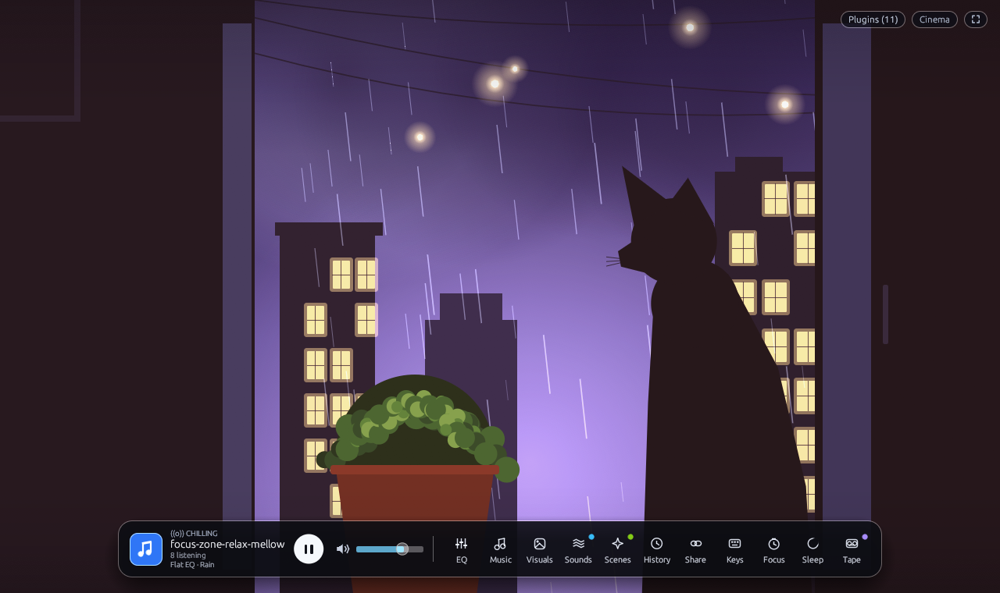

<div align="center">


# Kissa

### Your whisper-quiet, offline-first lofi café — built in 100% Pure Rust.

*No browser tabs. No Electron. No WebView2. Just cozy rain, warm beats, your own wallpapers & music, and ~73% less RAM.*

[](https://github.com/Ash2sh/kissa-lofi/actions/workflows/ci.yml)
[](https://github.com/Ash2sh/kissa-lofi/tags)
[](LICENSE)
[](https://www.rust-lang.org/)
[](plugins/README.md)

[Features](#features) ·
[Getting Started](#getting-started) ·
[Benchmarks](#why-pure-rust) ·
[Shortcuts](#keyboard-shortcuts) ·
[Plugins](#webassembly-plugins) ·
[Contributing](#contributing)

<br />



</div>

---

## What is Kissa?

Named after Japan's cozy, dimly lit listening cafés (*jazz kissa*), **Kissa** is a fast, distraction-free desktop lofi player inspired by the [LofiCafe](https://lofi.cafe/) website.

Most lofi apps run inside a browser tab or bundle Chromium/WebView2 — quietly burning 400–600 MB of RAM just to play rain and beats. Kissa replaces the entire browser stack with a **single 7 MB native Rust executable** (`eframe`/`egui` + `cpal` + `symphonia`) that launches instantly, works **100% offline**, and stays completely out of your way while you code, study, or unwind.

---

## Features

- **Atmospheric Scenes & Custom Wallpapers** — Includes 4 animated GPU scenes (*Rainy Window Cat*, *Neon Rain Skyline*, *Midnight Starlight*, *Warm Study Dusk*), or drop in your own **photos** (`.jpg`, `.png`, `.webp`, `.gif`) and looping **videos** (`.mp4`, `.webm`, `.mov`, `.mkv`) with live rain, warm tint, dimmer, and vignette overlays.
- **Instant Offline Radio + Your Music Library** — Start listening immediately with 4 built-in procedural lofi stations (*Chilling*, *Focusing*, *Drifting*, *Unwinding*), or scan your local `.mp3`, `.flac`, `.wav`, `.ogg`, `.m4a`, and `.aac` folders with shuffle, repeat, and seeking.
- **8-Layer Ambient Soundscape Mixer** — Blend *Rain*, *Vinyl*, *Fireplace*, *Thunder*, *Night Wind*, *Cafe*, *Forest*, and *Ocean* in real time over any station or local track.
- **5-Band EQ & Warm Tape Filter** — Shape your sound with a real-time stereo parametric equalizer, low-pass tape warmth cutoff, and custom presets.
- **Focus & Sleep Timers** — Stay in flow with a built-in Pomodoro timer, soft completion chime, and local session checklist — or drift off with a Sleep timer that smoothly fades out over 30 seconds.
- **One-Click Atmosphere Scenes & Offline Sharing** — Save your favorite visual + EQ + ambience + music combinations as Scenes, and share them offline using compact `lofi-scene-v1:...` codes.
- **Modular Dock & WebAssembly Plugins** — Every single button on the bottom dock is a toggleable plugin. Drop `.wasm` or `.wat` plugins onto the window to add new buttons and live DSP effects safely in a sandbox.
- **Private & Local-First** — Zero accounts, zero ads, zero telemetry. Everything stays on your machine.

---

## Getting Started

### Quick Install (Build from Source)

You only need the **[Rust toolchain](https://rustup.rs/)** — no Node.js, npm, or WebView2 required.

```bash
git clone https://github.com/Ash2sh/kissa-lofi.git
cd kissa-lofi
cargo run --release
```

> **Optional for local video wallpapers:** Install **[FFmpeg](https://ffmpeg.org/)** (`ffmpeg` and `ffprobe` on your `PATH`) to stream looping `.mp4` / `.webm` / `.mov` / `.mkv` videos in a single reused GPU texture. Photos, built-in scenes, and all audio work without FFmpeg.

<details>
<summary><strong>Linux System Dependencies</strong></summary>

On Debian/Ubuntu, install the native audio & windowing headers first:

```bash
sudo apt-get update
sudo apt-get install -y libasound2-dev libgtk-3-dev libxkbcommon-dev libwayland-dev libxcb-shape0-dev libxcb-xfixes0-dev
```

</details>

### Drag & Drop Anything

Once Kissa is open, simply **drag and drop files directly onto the window**:
- **`.mp3` / `.flac` / `.wav` / `.ogg` / `.m4a`** — adds to your local library and starts playing immediately.
- **`.mp4` / `.webm` / `.jpg` / `.png` / `.webp`** — sets as your live looping background wallpaper.
- **`.wasm` / `.wat`** — installs directly into your plugins folder and adds a new button to the bottom dock.

---

## Why Pure Rust?

Measured on Windows x64 (`--release`, LTO + stripped) while streaming an `854×480` H.264 video wallpaper + local MP3 + Rain ambience + Wasm Tape Lab DSP over 23 seconds:

| Workload | Previous WebView2 Build (`v0.1`) | Pure-Rust Native (`v0.2`) | Improvement |
| :--- | :---: | :---: | :---: |
| **Idle (Canvas Scene — RAM Working Set)** | `409.1 MB` *(7 procs)* | **`102.2 MB`** *(1 proc)* | **-75.0%** |
| **Video + Music + Rain (RAM Working Set)** | `519.2 MB` *(8 procs)* | **`140.9 MB`** *(3 procs)* | **-72.9%** |
| **Video + Music + Rain (Steady Private)** | `300.4 MB` *(8 procs)* | **`166.8 MB`** *(3 procs)* | **-44.5%** |
| **Video Decode Init Peak (Private)** | `460.9 MB` | **`167.1 MB`** | **-63.7%** |
| **Standalone Binary Size** | `5.29 MB` *(+ ~150 MB WebView2)* | **`6.96 MB`** *(zero runtime)* | **Self-contained** |

---

## Keyboard Shortcuts

Every control lives inside a compact floating dock at the bottom of the screen and responds instantly to the keyboard:

| Key | Action | Key | Action |
| :---: | :--- | :---: | :--- |
| `Space` | Play / Pause | `1` – `5` | `EQ`, `Music`, `Visuals`, `Sounds`, `Scenes` |
| `M` | Mute / Unmute | `6` – `0` | `History`, `Share`, `Keys`, `Focus`, `Sleep` |
| `↑` / `↓` | Volume Up / Down | `G` | Open **Plugin Manager** |
| `N` / `P` | Next / Previous Track | `H` | **Cinema Mode** (Hide / Show UI) |
| `F` | Toggle Fullscreen | `Esc` | Close Popover / Exit Cinema Mode |

---

## WebAssembly Plugins

Kissa's bottom dock is completely plugin-driven — all 10 built-in modules (`EQ` through `Sleep`) and every third-party WebAssembly plugin implement the same unified `LofiPlugin` trait.

- Press **`G`** (or click **Plugins** top-right) to hide any built-in dock buttons you don't use or install new `.wasm` / `.wat` plugins.
- Kissa automatically installs a starter external plugin (**Tape Lab**) so you can see third-party dock buttons and live Wasm DSP in action out of the box.
- Want to build your own? Read the **[WebAssembly Plugin ABI v1 Guide](plugins/README.md)** or inspect the readable example at [`plugins/rainy-lo-fi-warmth.wat`](plugins/rainy-lo-fi-warmth.wat).

---

## Roadmap

- [x] 100% Pure-Rust native UI (`eframe` / `egui` OpenGL) & real-time audio (`cpal` + `symphonia`)
- [x] 4 animated GPU scenes + local photo & single-buffer streaming video wallpapers
- [x] Unified `LofiPlugin` dock architecture + dynamic `wasmi` WebAssembly plugin sandbox
- [ ] Pre-built cross-platform release installers (Windows, macOS, Linux) via GitHub Actions
- [ ] Embedded ID3 / Vorbis cover art & track metadata for local music libraries
- [ ] System tray & OS media key integration (SMTC / MPRIS / MediaPlayer)
- [ ] Custom Wasm visual shader & ambient generator plugin hooks

---

## Contributing

Contributions of all kinds are welcome — bug fixes, new animated scenes, audio/DSP tweaks, cross-platform polish, and community WebAssembly plugins!

- Read **[CONTRIBUTING.md](CONTRIBUTING.md)** for setup steps, architecture overview, and PR guidelines.
- Check **[AGENTS.md](AGENTS.md)** if you are using AI coding agents on this repo.
- Found a bug, have an idea, or built a plugin? Open an **[Issue](https://github.com/Ash2sh/kissa-lofi/issues/new/choose)**.
- Please note that this project adheres to our **[Code of Conduct](CODE_OF_CONDUCT.md)**.

## Credits & License

- Visually and conceptually inspired by **[LofiCafe](https://lofi.cafe/)**.
- Licensed under the **[MIT License](LICENSE)**.

<div align="center">
  <br />
  <sub>If Kissa helps you focus or unwind, consider leaving a star on GitHub.</sub>
</div>
